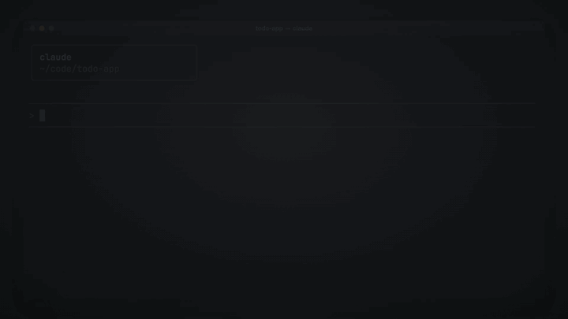
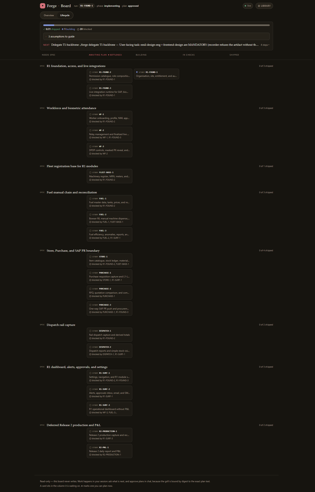

# Symphony Forge

[](https://github.com/knacklabs/symphony-forge/releases/latest)
[](https://github.com/knacklabs/symphony-forge/actions/workflows/forge.yml)
[](LICENSE)

Forge is a command-line tool that takes a change from an idea to a merged pull request. Your
coding agent, Claude Code or Codex, does the work. You make the decisions.



*Illustration of a real Forge flow, sped up: three changes build at the same time, Codex
reviews what Claude built, and only the change with a real problem gets a second round.*

You do three things:

- **Approve** the plan of a larger change.
- **Choose** when the agent gives you options.
- **Merge** the finished pull request yourself, or switch on agent merges once and let the agent merge it.

The agent does the rest. It writes the plan, has a second agent read it, builds each part in
its own branch, runs the tests, gets a code review and fixes what the review finds.

## Quick start

You need [git](https://git-scm.com/), the [GitHub CLI](https://cli.github.com/) signed in,
[uv](https://docs.astral.sh/uv/), and Claude Code or Codex. Code reviews also need the
Autoreview skill from [openclaw/agent-skills](https://github.com/openclaw/agent-skills), at the
version Forge pins. When you ask your agent to set up Forge, its setup check names that version
and where to install it. Forge runs on macOS, Linux and Windows.

1. Install Forge. This is the only command you type:

   ```sh
   uv tool install --python 3.11 "git+https://github.com/knacklabs/symphony-forge@v1.2.41"
   ```

2. Open Claude Code or Codex in your repo and say:

   > Set up Forge in this repo.

   The agent sets up the settings file, the agent instructions, the CI workflow and the git
   hooks, and checks the setup. It works in an empty repo and in a repo that already has code.

3. Then say what you want, in your own words:

   > The due-date filter shows yesterday's tasks. Fix it.

   > What needs me?

If you do not code, give your agent the text in [Start with Claude](docs/start.md) and it sets
up the computer for you.

## How Forge checks the work

1. **The builder and the reviewer can be different models.** A Claude Code session can build
   with its own Claude helpers, or hand the build to Codex. A Codex session can do the same the
   other way round. In a new repo with both tools, code reviews run on Codex `gpt-6.1-terra` at
   max effort. A plan read runs on the tool that is not the session's: Codex `gpt-6.1-terra` at
   max effort from a Claude session, or Claude Sonnet 5.5 at high effort from a Codex session.
   A Claude-only repo uses Claude Sonnet 5.5 at high effort for both.
2. **Each change starts small.** In a new repo, the first build or fix round runs at low
   effort: Claude Sonnet 5.5 or Codex `gpt-6.1-sol`. User-facing work uses the design settings,
   which start higher. After a failed test, a blocking review finding or a failed
   required check, the same builder continues at higher effort: high on Codex, xhigh on Claude.
   The board shows "built at <effort>" for each round.
3. **Only what matters gets fixed.** The review stops the work only for findings worth their
   cost. Other notes become follow-ups or known issues. See
   [how Forge weighs a note](docs/review-rules.md).

## How a change goes from idea to merge

A *pull request* is a proposed change to the code. *Merging* it makes the change part of the
project.

1. **Plan.** The agent writes one short page: what changes for you, why, when it is done, and
   the tasks.
2. **Cold read.** A second agent that did not write the plan reads it and lists the gaps. The
   agent fixes the plan. By default there are at most two rounds.
3. **Approve.** You approve the plan once. Nothing is built before that.
4. **Build.** Each task gets its own branch and its own folder, so tasks do not get in each
   other's way. A Claude or Codex worker writes the code and the tests.
5. **Review and tests.** A separate code review reads the change, and the tests must pass. A
   serious finding goes back to the worker. Only then is the pull request ready.
6. **Merge.** You merge the pull request. Or you switch on agent merges yourself, once: run
   `forge merge enable` in your own terminal, outside Claude Code or Codex, and merge the pull
   request it opens ([merging](docs/guide.md#merging-a-ready-item)). After that, the agent merges
   ready pull requests. In a client repo before the client's sign-off is accepted, the agent
   merges ready changes by itself.

Forge picks one of two sizes for each change:

| | Story | Fix |
|---|---|---|
| **When** | The change touches an interface or more than five code files | A small change |
| **Plan** | A plan, the cold read and your approval | One line of why and a "done when" |
| **Build** | One branch for each task | One branch |
| **Before merge** | Code review and passing tests | Code review and passing tests |

## What you can see

**The board.** Ask your agent to open the board. It is a live page on your computer that shows
what is in progress, what waits for you and what has merged, in plain English.



**The Forge pane in Claude Code.** It shows the builds, tests and reviews that run on your
computer now. You can open a run's output or stop a run. It was checked in a terminal. Nobody
has checked it in the Claude desktop app yet.

[Commands your agent runs](docs/commands.md)

## Settings, starters and upgrades

Your agent keeps Forge's one settings file, can start a new app from a starter, and upgrades
Forge when you ask. The [guide](docs/guide.md) explains each one, and the
[prototype checklist](docs/start-a-prototype.md) covers a new client app.

## Where it comes from

Forge builds on OpenAI's
[Symphony spec](https://openai.com/index/open-source-codex-orchestration-symphony/)
(April 2026): hand whole pieces of work to agents. Forge adds an approved plan, a code review
and passing tests before each change merges.

## Learn more

- [Forge guide](docs/guide.md): installing, the flow, workers and models, closing, merging,
  upgrading and releasing.
- [How Forge weighs a note](docs/review-rules.md): the scores, the bar and when a loop stops.
- [Standards](src/forge/standards.md): the engineering rules every worker follows.
- [Specs](docs/specs/): the designs behind how Forge behaves, starting with
  [Forge v1](docs/specs/lean-forge-v1.md).
- [Release notes](https://github.com/knacklabs/symphony-forge/releases): what changed in each
  release, and its known issues.

## Contributing

See [CONTRIBUTING.md](CONTRIBUTING.md).

## License

[MIT](LICENSE)
